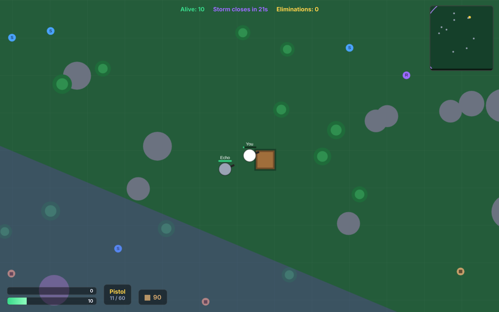

<div align="center">

# 🏆 BuildRoyale

**A Fortnite-style battle royale that runs entirely in your browser — build, fight, survive the storm.**

Peer-to-peer over WebRTC · no game server · drops straight onto GitHub Pages.

[](https://bara-almustafa.github.io/buildroyal/)
[](https://bara-almustafa.github.io/buildroyal/)
[](#how-it-works)
[](LICENSE)



</div>

---

## What is this?

**BuildRoyale** is a top-down battle royale inspired by the Fortnite loop — **loot, shoot,
build walls for cover, and shrink into the final circle**. It's an *original* game (its own
art and code, no copyrighted assets), built to be the simplest possible thing that still
feels like a real battle royale.

The whole match runs **browser-to-browser over WebRTC** ([PeerJS](https://peerjs.com/)):
one player hosts, friends join with a 6-character room code, and gameplay traffic flows
**directly between browsers**. There's no backend to deploy or pay for — which is exactly
why the entire game is a **static site you can copy-paste onto GitHub Pages**.

## Play

| Mode | How |
|------|-----|
| **Solo vs bots** | Click *Play solo vs bots* — instant, works offline. |
| **With friends** | One player *Host a match* → shares the room code → others *Join* → host hits *Drop in!* |

### Controls

| Key | Action | Key | Action |
|-----|--------|-----|--------|
| `WASD` | Move | `Q` | Build wall |
| Mouse | Aim | `F` | Build ramp |
| Click | Shoot | `R` | Reload |
| `1` / `2` | Switch weapon | `E` | Pick up loot |
| `Shift` | Sprint | | |

Walls cost **10 materials**. Grab loot (`E`) for weapons, shields, and mats. Stay inside the
purple circle — the storm closes in and bites harder every phase. **Last one standing wins.**

## Features

- 🔫 **5 weapons** — pistol, SMG, rifle, shotgun, sniper, each with its own damage, spread, and fire rate
- 🧱 **Building** — place grid-aligned walls and ramps for instant cover
- 🌩️ **Shrinking storm** — six escalating damage phases that funnel everyone together
- 🎒 **Loot** — weapons, shield potions, and materials scattered across a seeded map
- 🤖 **Bot AI** — fills empty lobbies so solo and small matches still feel alive
- 🗺️ **Minimap, kill feed, HUD** — health, shield, ammo, mats, eliminations at a glance
- 📱 **Touch controls** — dual sticks on mobile
- 🌐 **True P2P** — no server; a seeded world keeps every peer in sync

## How it works

BuildRoyale uses a **host-authoritative star** topology:

```
            input ▲          ▼ snapshots (~20 Hz)
   ┌────────┐   ┌─────────────────┐   ┌────────┐
   │ client │◀─▶│   HOST (sim)    │◀─▶│ client │
   └────────┘   │  players,       │   └────────┘
   ┌────────┐   │  bullets, storm │   ┌────────┐
   │ client │◀─▶│  loot, bots     │◀─▶│ client │
   └────────┘   └─────────────────┘   └────────┘
```

- The **host** runs the entire simulation and broadcasts ~20 snapshots per second.
- **Clients** send their input up and render interpolated snapshots down, with light
  **client-side prediction** on their own movement so it feels responsive despite the round-trip.
- The map is generated from a shared **seed**, so every peer builds the identical world.
- Matchmaking uses PeerJS's free public broker only to *introduce* peers; actual gameplay
  packets are direct WebRTC.

> **NAT note:** the public STUN/broker works on most networks, but strict/symmetric NATs may
> fail to connect directly. For a bulletproof public deployment, point PeerJS at your own
> PeerServer + a TURN server in [`js/net.js`](js/net.js).

## Project structure

```
buildroyal/
├── index.html          # menu · lobby · HUD markup
├── css/
│   └── style.css       # all styling
├── js/
│   ├── net.js          # WebRTC transport (PeerJS wrapper)
│   └── game.js         # simulation · rendering · input · bots
├── docs/
│   └── screenshot.png  # gameplay still
├── .nojekyll           # serve files as-is on Pages
└── .github/workflows/
    └── pages.yml        # auto-deploy to GitHub Pages on push
```

## Run it locally

No build step — it's plain HTML/CSS/JS. Just serve the folder:

```bash
git clone https://github.com/bara-almustafa/buildroyal.git
cd buildroyal
python3 -m http.server 8000     # or: npx serve .
# open http://localhost:8000
```

## Deploy your own copy

This is a static site, so **copy-paste deploy**:

1. Fork or push these files to a repo.
2. **Settings → Pages → Source → GitHub Actions** (the included workflow handles the rest),
   *or* **Deploy from a branch → `main` / root**.
3. Live at `https://<you>.github.io/<repo>/`.

## Roadmap

- [ ] Pickaxe harvesting (farm mats from trees/rocks)
- [ ] Self-hosted PeerServer + TURN for any-NAT reliability
- [ ] Squads / teams
- [ ] More structures (floors, stairs, editing)

## License

[MIT](LICENSE) — do whatever you want.
